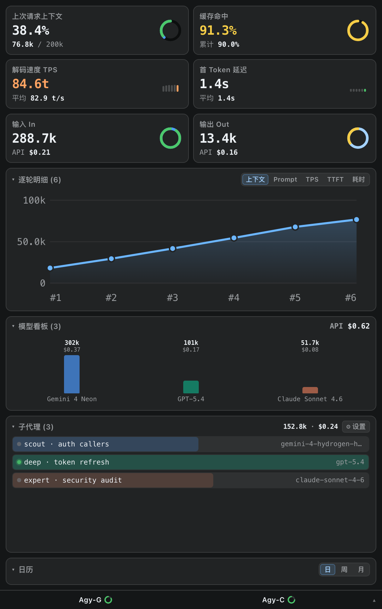
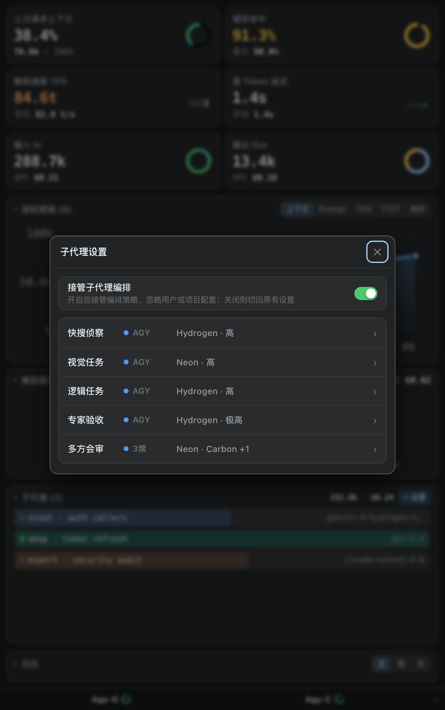

# AGY Cockpit

[](https://github.com/royjiang1982/agy-cockpit)
[](./plugin.json)
[](https://www.python.org/)
[](./LICENSE)

**English** | [简体中文](./README.zh-CN.md)

**AGY Cockpit** is a real-time observability cockpit and multi-engine subagent orchestration plugin for **Google Antigravity**. Monitor context window usage, prompt cache hit rate, TPS/TTFT, token spend, and model quotas in the side pane — and centrally manage multi-engine subagent routing, resident execution, and safety guard hooks.

## Preview

<table>
  <tr>
    <td align="center" width="50%">
      
      <br />
      <sub><b>Real-Time Cockpit Panel</b> (demo data)</sub>
    </td>
    <td align="center" width="50%">
      
      <br />
      <sub><b>Subagent Orchestration Settings</b> (demo data)</sub>
    </td>
  </tr>
</table>

## Key Features

- **Real-Time Metrics Dashboard**: Tracks context window utilization, prompt cache hit rate, decode speed (TPS), time-to-first-token (TTFT), per-turn trends, model cost breakdown, subagent consumption, and live quota rings.
- **5-Role Subagent Orchestration**: Ships with the `cockpit-dispatch` skill and a zero-port local policy resolver (`resolve.py`) that routes tasks across 5 general-purpose roles with automatic fallback chains:
  - `scout` (read-only fast research)
  - `standard` (UI, visual & content tasks)
  - `deep` (backend logic, architecture & data pipelines)
  - `expert` (debugging, security/billing audit & acceptance)
  - `panel` (read-only multi-seat blind review)
- **Self-Contained Resident Runtime**: Bundles `sa-subagentd` (Unix socket daemon) and engine wrappers (`sa-agy`, `sa-codex`, `sa-droid`, `sa-grok`, `sa-pi`) plus `sa-run.sh` for persistent connection reuse and multi-turn session resume.
- **Native PreToolUse Safety Guard**: Automatically registers `hooks.json` (`sa-guard.sh agy`) to block recursive subagent spawning and high-risk shell/git commands inside subagent sessions.

## Repository Layout

```text
agy-cockpit/
├── plugin.json                 # Antigravity plugin manifest
├── hooks.json                  # Native PreToolUse safety guard hook
├── install.sh                  # One-way installer with syntax & hash verification
├── rules/AGENTS.md             # Minimal always-on dispatch trigger rule
├── skills/cockpit-dispatch/    # 5-role dispatch skill + local policy resolver
├── runtime/                    # Self-contained resident daemon, wrappers, runner & sa-guard
└── sidecars/cockpit/           # Sidecar HTTP server, UI & unit tests
```

## Quickstart

```bash
# Install / sync into ~/.gemini/config/plugins/agy-cockpit
./install.sh

# Run Sidecar and safety-guard unit tests
PYTHONDONTWRITEBYTECODE=1 python3 -m unittest discover -s sidecars/cockpit -p "test_*.py"
python3 runtime/tests/test-sa-guard.py
```

After installation, reload Antigravity and open the **AGY Cockpit** panel from the sidebar (or click the **Settings** button inside the Subagents section to toggle orchestration takeover and customize per-role routes).
