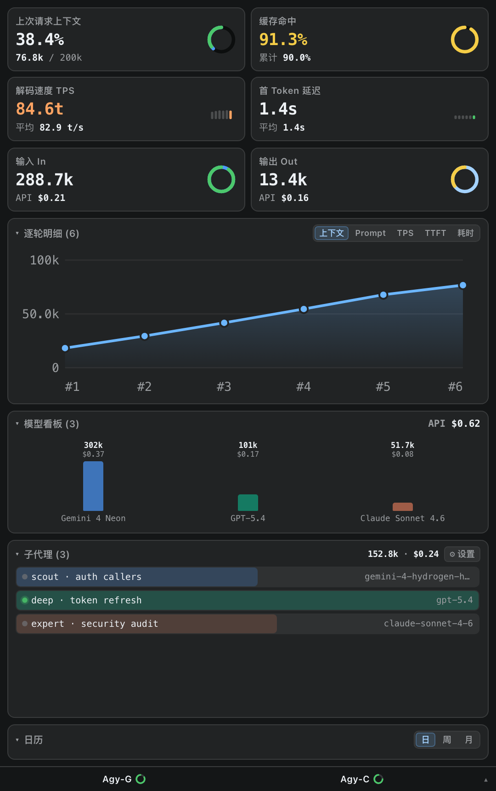
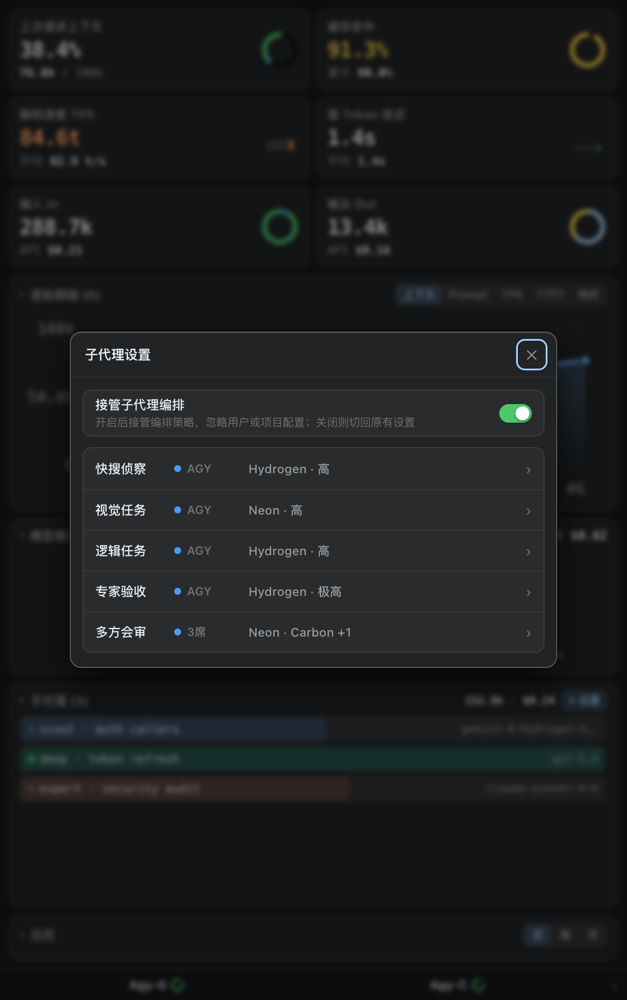

# AGY Cockpit

[](https://github.com/royjiang1982/agy-cockpit)
[](./plugin.json)
[](https://www.python.org/)

[English](./README.md) | **简体中文**

**AGY Cockpit** 是面向 **Google Antigravity** 的实时驾驶舱与多引擎子代理编排中心插件：在侧边栏实时监控上下文窗口占用、缓存命中率、TPS/TTFT、子代理消耗与模型配额，并统一接管多引擎子代理路由、常驻执行与安全守卫。

## 界面预览

<table>
  <tr>
    <td align="center" width="50%">
      
      <br />
      <sub><b>实时指标驾驶舱</b>（模拟演示数据）</sub>
    </td>
    <td align="center" width="50%">
      
      <br />
      <sub><b>子代理编排设置抽屉</b>（模拟演示数据）</sub>
    </td>
  </tr>
</table>

## 核心能力

- **实时指标驾驶舱**：侧边栏可视化展示上下文窗口占用、缓存命中率、解码速度（TPS）、首 Token 延迟（TTFT）、逐轮趋势图、模型成本看板、子代理消耗与底部配额环。
- **5 角色子代理编排**：内置 `cockpit-dispatch` Skill 与零端口本地路由解析器（`resolve.py`），按 5 个通用角色自动路由与回退：
  - `scout`（快搜侦察，只读）
  - `standard`（视觉与图文任务）
  - `deep`（逻辑研发与流水线任务）
  - `expert`（疑难排错与专家验收）
  - `panel`（多方独立盲审，只读）
- **自包含常驻运行时**：内置 `sa-subagentd` 守护进程与多引擎包装器（`sa-agy` / `sa-codex` / `sa-droid` / `sa-grok` / `sa-pi`）以及 `sa-run.sh`，支持常驻连接复用与多轮会话续接。
- **原生安全守卫钩子**：通过根目录 `hooks.json` 自动挂载 `PreToolUse` 守卫（`sa-guard.sh agy`），防止子代理套娃派生与高危命令误执行。

## 目录结构

```text
agy-cockpit/
├── plugin.json                 # Antigravity 插件清单
├── hooks.json                  # 原生 PreToolUse 安全守卫钩子
├── install.sh                  # 带语法预检与哈希校验的单向安装脚本
├── rules/AGENTS.md             # 极短常驻派发触发规则
├── skills/cockpit-dispatch/    # 5 角色派发手册与零端口本地策略解析脚本
├── runtime/                    # 自包含常驻守护进程、引擎包装器、执行器与守卫脚本
└── sidecars/cockpit/           # Sidecar HTTP 服务、前端面板与单测
```

## 快速开始

```bash
# 安装 / 同步到本机插件目录（~/.gemini/config/plugins/agy-cockpit）
./install.sh

# 运行 Sidecar 与守卫单测
PYTHONDONTWRITEBYTECODE=1 python3 -m unittest discover -s sidecars/cockpit -p "test_*.py"
python3 runtime/tests/test-sa-guard.py
```

安装完成后重载 Antigravity，即可在侧边栏打开 **AGY Cockpit** 面板；点击「子代理」栏右上角 **设置** 可随时开启/关闭「接管子代理编排」并自定义各角色路由。
